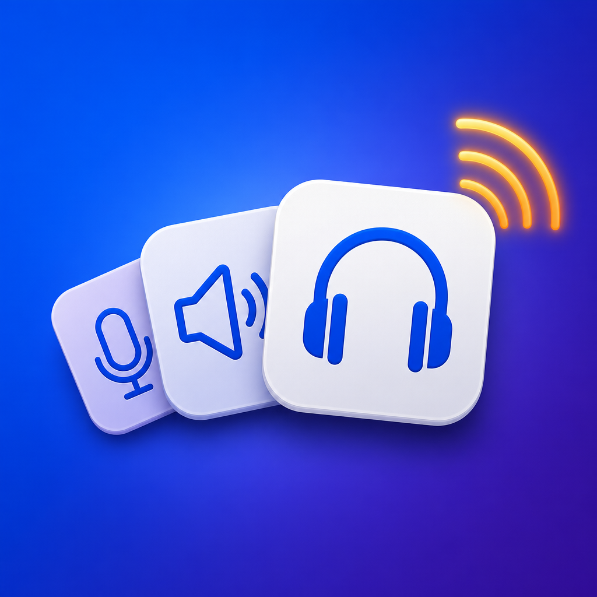
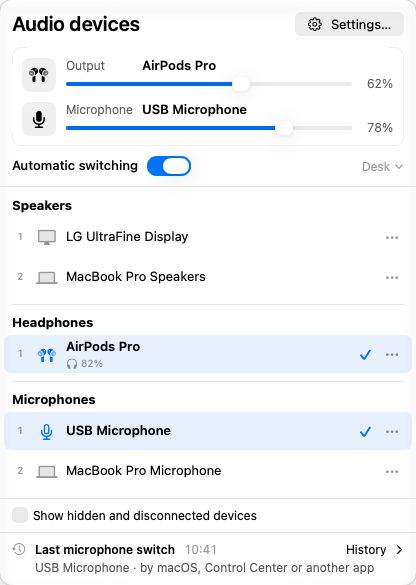

<p align="center">
  
</p>

<h1 align="center">Audio Priority Bar</h1>

<p align="center">
  Rank your headphones, speakers, and microphones once.<br>
  Your Mac uses the best one that's connected.
</p>

<p align="center">
  
  <a href="LICENSE"></a>
</p>

<p align="center">
  <picture>
    <source media="(prefers-color-scheme: dark)" srcset="screenshot-dark.png">
    
  </picture>
</p>

## Why

| When | macOS on its own | Audio Priority Bar |
| --- | --- | --- |
| A display connects | Sound can move to its speakers | Sound stays on your top device |
| AirPods take over on their own | They keep the sound | It switches back to your choice |
| You mute your microphone | In each app | Once, for every app |

## Highlights

- **Switches for you.** Headphones first, then speakers, and your top microphone.
- **Tells you.** A brief notice under the menu bar icon names the device it just picked.
- **Mute from anywhere.** <kbd>⌥</kbd> <kbd>⇧</kbd> <kbd>M</kbd> in any app, or from Shortcuts, Raycast, or a Stream Deck. The menu bar icon turns red while muted.
- **Shortcuts actions.** Set the output or microphone, mute, or turn automatic switching on or off from a shortcut.
- **Profiles.** Keep a set of device orders for each setup and switch from the panel, a shortcut, or a Focus.
- **Bluetooth in one click.** Connect and disconnect paired speakers and headphones from the panel.
- **Battery at a glance.** AirPods buds and case, and Jabra headsets on a Link dongle.
- **Jabra headset settings.** Switch noise cancellation, HearThrough, sidetone and the busylight on a Jabra headset on a Link dongle, from its row, or light the busylight while an app uses its microphone. Tested on an Evolve2 85.
- **Native.** Laid out like the macOS Sound menu, with Liquid Glass on macOS 26, VoiceOver support, and automatic updates in builds configured with a release feed.

## Install

This fork runs on macOS 14 Sonoma or later on Apple silicon and Intel. Build the branch you want using the instructions below, then copy `dist/AudioPriorityBar.app` to `/Applications`. [Build from source](#build-from-source)

When this fork publishes a release, you can download `AudioPriorityBar.zip` and its `.sha256` file together. Verify the archive with `shasum -a 256 -c AudioPriorityBar.zip.sha256` in the download directory before unzipping it. [Fork releases](https://github.com/anazaryan-krisp/Audio-Priority-Bar/releases)

Local builds are unsigned and use manual upgrades. When macOS requests first-launch approval, open **System Settings > Privacy & Security** and choose **Open Anyway**.

<details>
<summary>Upgrading from V1</summary>

V2 imports V1 settings once on first launch (existing V2 values win). The new
bundle identifier may require re-approving Input Monitoring or Open at Login.

</details>

## Use

Click the menu bar icon to see the current output and microphone at the top of
the panel. A checkmark marks each one in its priority list. Click a device to
use it or drag it to change its priority. Click **Settings…** in the upper-right
corner, or press **⌘,** while the panel is open, to configure the app.
After a switch, the panel shows the device, time, and reason. Click **History**
to see the last 20 switches since launch.

[Watch the audio switching demo (earlier interface).](demo.gif)

<details>
<summary>How switching works</summary>

- Automatic switching uses the first available headphone, then the first speaker.
- An output you pick in the panel, Control Center or Sound Settings stays
  until it disconnects or a device your list would pick connects, and
  automatic switching stays on. Other devices coming and going leave it
  alone. With automatic switching off, it stays until you turn it back on.
- When macOS or another app changes the output on its own, as AirPods do when
  you put them in, Audio Priority Bar switches back to the device you picked,
  or to your list. A device you connect still takes over if your list would
  pick it.
- If macOS takes the output again right after a switch back, as AirPods in
  your ears can, Audio Priority Bar leaves it and names it in the panel, since
  each round trip is a gap in the sound. **Fix in Settings** opens the AirPods
  settings, where choosing **When Last Connected to This Mac** under **Connect
  to This Mac** stops them switching on their own.
- Changing the system microphone to another connected input keeps that input
  until it disconnects or you choose again. This works in either mode, including
  when an app changes the input to already-connected AirPods. Connecting other
  devices leaves that choice in place. Applying a profile or switching modes
  starts a new choice. A microphone selected only inside a call app remains
  under that app's control.
- When a microphone first connects, automatic mode uses the saved priorities.
  With automatic switching off, a newly connected headset can take the output
  while the existing microphone stays selected. A USB headset can bring its
  microphone too when its halves are linked and there is no external mic choice.
- With **Select headset input and output together** enabled, choosing
  either half of a physical USB headset selects the other too. For a dock or
  an audio interface whose microphone you'd rather rank yourself, uncheck
  **Use Its Microphone Too** in its row's actions menu.
- With **Microphones follow the output** enabled, speakers and headphones
  each keep their own microphone order, so moving from headphones to
  speakers can also move to the desk microphone. A microphone you pick in
  another app as the system input stays selected across output changes.
- With **Mute speakers when headphones disconnect** enabled, the app asks the
  speaker that takes over to mute. Some monitors only allow muting through their
  own controls. The panel identifies the speaker if macOS cannot mute it.
- Microphone mute covers the current input and connected physical wired inputs
  that the app can silence, including hidden inputs. It follows device changes
  and restores the original mute or input level on unmute or quit. If a device
  is unavailable, restoration retries when it reconnects.

Both modes use the same Speakers, Headphones, and Microphones lists.

</details>

<details>
<summary>Device controls</summary>

- Drag outputs within or between Speakers and Headphones.
- Reorder microphones within Microphones. With **Microphones follow the
  output** on, its heading shows **With speakers** or **With headphones**;
  pick the other to edit that order without switching anything.
- Move through the panel with Up and Down, as in a menu. Return or Space uses
  the highlighted device, mutes or unmutes a volume row, flips a switch, or
  opens Settings. Left and Right change the highlighted volume, profile, or
  microphone order, Right opens a device's actions menu, and Escape closes
  the panel.
- Open a row’s ellipsis menu for keyboard-accessible Move Up, Move Down, and
  Move to commands. Right-click a row to open the same menu.
- Hide a device to remove it from Speakers, Headphones, or Microphones, or
  keep it visible while blocking automatic selection with **Never
  Auto-Select**.
- Use **Show hidden and disconnected devices** to manage hidden and
  disconnected remembered devices.
- Forget a disconnected device to remove its saved settings.
- Paired Bluetooth speakers and headphones stay listed at their rank while
  they are off, dimmed. Click one to connect and use it. Hide one you never
  use to take it off the list.
- A Bluetooth device that is connected but not in use shows **Connected**.
  Hover it and click **Disconnect** to release it.
- A device with a paired counterpart, like a USB headset's input and output
  halves, shows an override for the current default: **Mic only** or
  **Output only** while **Select headset input and output together** is on,
  or **Use both** while it's off. It appears only when picking it would
  change something, and the actions menu offers it too.
- Set the output volume and microphone level by slider or scroll wheel. Click
  the device icon beside a slider to mute. The channel shows **Muted**.
- Speakers and headphones are sorted by what each device reports, in any
  system language.

New HDMI and DisplayPort outputs start hidden; showing one is permanent, and
**Hide new HDMI and DisplayPort outputs** turns this off for future devices.
The active device always stays listed, even when hidden.

If a monitor reconnects with the same display UUID and a different port suffix,
or a USB audio device without a serial number moves to another port, the app
keeps its priority and visibility. When it sees two matching devices connected
at once, it remembers to keep their settings separate.

</details>

<details>
<summary>Menu bar icon</summary>

- The icon shows the current output, like AirPods or headphones, and
  optionally the microphone, labeled in and out if you like. Unlabeled, a mic
  that belongs to the output, like the AirPods mic, shares its icon.
- It can be outlined in Settings to tell it apart from the Sound icon, and can
  show the volume level beside any device icon. Settings previews the icon as
  you change it.
- A muted microphone shows in red and pulses, unless you turn the pulse off in
  Settings.
- The icon can turn red while automatic switching is off, as a reminder to
  turn it back on.
- Hovering the icon shows the current output and microphone.
- Option-click the icon to mute the microphone. Right-click it to mute the
  microphone, or for Settings, Check for Updates, and Quit.
- A **Microphone muted** reminder appears when an app starts recording while
  you are muted. Click it to hide it until you next record while muted. It
  and the switch notices can each be turned off in Settings. On macOS 14.2
  and later the app checks which devices processes use for input. On 14.0–14.1
  activity on a device that supports both playback and recording triggers a
  precautionary mute reminder and defers updates until the device is idle.
- While muted, a Bluetooth headset microphone that isn't the one in use stays
  live, since muting it could drop its sound to call quality. If an app records
  from it, the reminder names both, for example "Google Chrome is using AirPods
  Pro, which isn't muted".

</details>

<details>
<summary>Jabra Link headsets</summary>

The app asks a Jabra Link dongle directly whether its wireless headset is
powered off, since CoreAudio can't tell, and falls back automatically in
under a second. Right after replugging, it briefly shows the headset as off
while the wireless link re-establishes, which is expected, not a bug.

Link 380 is hardware-verified. Link 390 uses the same detection but is
unverified on hardware
([details](https://github.com/tobi/AudioPriorityBar/pull/32)). An
unrecognised dongle fails open rather than being treated as off.

Once the headset answers, its row also offers the settings it keeps itself:
noise control (Off, Noise Cancellation or HearThrough), sidetone to hear your
own voice in calls, and the busylight. While a call or an app uses the
microphone, HearThrough isn't available, and sidetone replaces noise control
when it's on. A call keeps the busylight on until it ends. A call started with
the headset's call button ends from the red button on the row. In **Settings >
Devices**, enable **Turn on the busy light when the headset mic is in use** to
cover calls in apps that don't signal one, such as Meet or Teams in a browser.
This option is off by default. Tested on an Evolve2 85 behind a Link 380.

</details>

<details>
<summary>Profiles</summary>

A profile keeps its own Speakers, Headphones, and Microphones orders and
whether automatic switching is on, for setups like Desk, Meeting, or Travel.
Hiding, Never Auto-Select, and the other settings are shared by all of them.

- Your current setup is the first profile, **Default**. Add more in
  **Settings > Profiles**; each starts as a copy of the one in use. Click a
  name to rename it, or choose **Edit Profiles…** in the panel's profile
  menu.
- Rearranging the panel changes the profile in use, with nothing to save.
- With two or more, the panel heading shows the profile in use; pick another
  there, in Settings, or with the **Apply Profile** shortcut.
- Applying a profile selects its top devices at once. One with automatic
  switching off picks them and then holds them.
- Under **System Settings > Focus**, add Audio Priority Bar as a Focus filter
  to apply a profile while that Focus is on. The profile from before returns
  when it ends.
- Forgetting a device removes it from every profile. Profiles never drop a
  device on their own.

</details>

### Automation

The Shortcuts app lists five actions: **Set Output**, **Set Microphone**,
**Set Microphone Mute**, **Set Automatic Switching**, and **Apply Profile**.
Picking a device works like a click in the panel, and a device that isn't
connected stops the shortcut with its name.

URLs control the microphone mute and automatic switching from Shortcuts,
Raycast, a Stream Deck, or Terminal:

```bash
open "audioprioritybar://toggle-mic-mute"
open "audioprioritybar://mute-mic"
open "audioprioritybar://unmute-mic"
open "audioprioritybar://toggle-automatic"
open "audioprioritybar://enable-automatic"
open "audioprioritybar://disable-automatic"
```

In Shortcuts, add an **Open URLs** action with one of them. The app opens if it
isn't running. Any other form of the URL is ignored. **Settings > Shortcuts**
lists the supported URLs with a Copy button next to each one.

### Permissions

| Permission | When it's asked |
| --- | --- |
| Bluetooth | The first time you connect or disconnect a device from the panel |
| Input Monitoring | May be asked, to tell when a Jabra Link headset is off |
| Accessibility | Optional, only from Settings, to keep the hover preview off while macOS hides the icon |
| Login Items | Open at Login may need approval in **System Settings > General > Login Items**, which Settings opens for you |

The mute shortcut needs no permission.

## Contributing

Issues and pull requests are welcome. Open an issue first for anything
substantial, then branch from `develop` and open the pull request against
`develop`. See [CONTRIBUTING.md](CONTRIBUTING.md).

**Settings > Switch History** shows the last 20 switches and why each happened.
For a bug report, use **Copy Diagnostics** in **Settings > Diagnostics**. For a
detailed log, turn on **Keep a debug log on this Mac**, reproduce the issue,
and click **Export Redacted Log**. Both exports replace owner names,
Bluetooth addresses, serial numbers and display IDs with short tags.

### Build from source

```bash
git clone https://github.com/anazaryan-krisp/Audio-Priority-Bar.git
cd Audio-Priority-Bar
./build.sh
```

The universal app is written to `dist/AudioPriorityBar.app`. The build script disables app signing and leaves the update feed empty.
You can also open `AudioPriorityBar.xcodeproj` in Xcode and build with Command-R.

For local development, `./build.sh --dev` builds only your machine's
architecture in the Debug configuration, which is much faster, and writes
`dist/AudioPriorityBar-dev.app`. To create a universal distribution ZIP with the same defaults, run `scripts/package-release.sh --unsigned`. It writes the ZIP and checksum to `release/` and preserves other files in your output and build directories.

## License

[GPL-3.0](LICENSE)

## Acknowledgments

Originally created by [tobi](https://github.com/tobi).

The Jabra GNP framing and pairing-record query are based on
[jabridge](https://github.com/Watchdog0x/jabridge) by Watchdog0x (Apache-2.0).

Built with SwiftUI, AppKit, CoreAudio, and IOKit.
